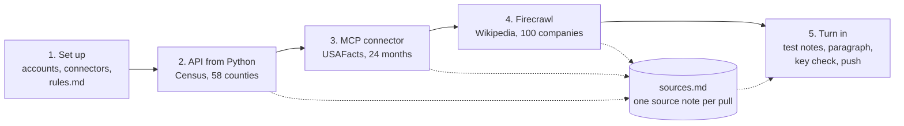

# Workshop 3: getting the data

In a capstone, the client's data often arrives late, thin, or locked behind an
agreement. The same thing happens when you build a project for a job you're
applying to, because that company's data isn't yours to use. In both cases you
find data somewhere else and pull it yourself.

This workshop is a tour of three methods for getting data. A method is the way
data gets from its source to a file on your disk, and a pull is one use of a
method. You'll make one small pull with each method and write down what you
did, so someone else could repeat it.

Here is the whole tour. Each pull makes a data file and adds a source note to
`workshop-03/sources.md`, and that file is what you turn in.



Before you pick a method, find the source of the data and the form it comes
in. The form decides the method.

| Section | Method                    | Try it when                      | What it costs you                               |
| ------- | ------------------------- | -------------------------------- | ----------------------------------------------- |
| 2       | An API called from Python | The source offers an API         | You have to know the source                     |
| 3       | An MCP connector          | A connector reaches the source   | No script, and the rows pass through your agent |
| 4       | Firecrawl                 | The data sits only on a web page | It breaks when the page changes                 |

Work through the sections in order. They run in the order I'd try the methods.
Two forms have no section. If the source offers a file to download, get the
file and write the same source note. If nobody publishes the data, choose a
stand-in and say what it misses.

## How this workshop works

There's no class meeting for this workshop. You work through it on your own
schedule, and the due date is in the Workshop 3 assignment in Brightspace.

This guide is the lesson. It has every prompt, command, and check, so you can
finish with the guide alone. The videos are in the Workshop 3 module in
Brightspace. They show the same steps on my screen, so you know what a part
looks like before you try it.

Start with the first video, which covers the ideas: sources, methods,
requests, and source notes. Then work through the parts in order. For each
one:

1. Watch that part's video all the way through, without typing. Each one runs
   a few minutes.
2. Do the part from this guide. Copy the prompts and commands from here, not
   from the video.
3. Check the line that starts "You're done with this part when." Then go to
   the next item in Brightspace.

Your screen won't match mine word for word, because your agent writes its own
answers. Go by what this guide says you should see. The videos also leave out
what I wrote in my own source notes, because those answers are yours to write.

The voice in the videos is an AI voice reading a script I wrote. I can fix a
mistake in a video in a few minutes that way.

## What you turn in

This is what I check for Credit:

- Three data files in `workshop-03/data/`, or a source note with the error
  for a method that failed.
- Your pull script in `workshop-03/pulls/`.
- Three source notes, each with five answers and the two values you compared.
- The source you checked, with your decision.
- Your paragraph, in your own words.
- The key check line in `workshop-03/sources.md`.

## 1. Set up

Open your `meridian-capstone` repo in VS Code. This workshop doesn't use the
Meridian case. You're using the repo because your Workshop 1 and 2 work is
already there.

### Create two accounts

Both accounts are free, and you don't enter a card for either one.

1. Request a Census key at https://api.census.gov/data/key_signup.html.
2. Open the email from the Census Bureau.
3. Select the activation link in that email.
4. Copy the student code shown at https://www.firecrawl.dev/student-program.
5. Sign up for Firecrawl with your LMU email.
6. In Firecrawl, open Settings, then Billing.
7. Enter the student code.

The Census email can take a while, so go on with step 4. If it never comes,
section 2 has an API that needs no key. If the student code doesn't apply,
the free plan at https://www.firecrawl.dev/pricing has enough credits.

You're done with this part when the Census Bureau has your key request, and
the Billing page in Firecrawl shows your credits.

### Add two connectors

Your agent can do only what its tools let it do. Out of the box, Claude Code
can read and write files, run commands, and search the web. MCP, the Model
Context Protocol, is a standard way to give it more tools. Its own docs at
https://modelcontextprotocol.io compare it to a USB-C port: any service built
to the standard plugs into any agent that supports it.

A service built this way is an MCP server, and Claude's apps call it a
connector. Each connector adds tools your agent can call, such as "list the
sources" or "get this data series." You ask in plain words, and your agent
picks the tool and fills in the request:

```text
you → your agent → the connector → the service's own API → data
```

You'll add two connectors now. USAFacts reaches government data, and
Firecrawl reads web pages.

Open a new terminal in VS Code with your repo open. If Claude Code is running
in it, enter `/exit` first. Then run these two commands:

```text
claude mcp add --transport http usafacts https://data.mcp.usafacts.org/mcp
claude mcp add --transport http firecrawl https://mcp.firecrawl.dev/v2/mcp-oauth
```

1. Start Claude Code.
2. Enter `/mcp`.
3. Choose `firecrawl`.
4. Sign in through your browser.
5. Return to the terminal.
6. Check that `usafacts` and `firecrawl` both show as connected.

USAFacts needs no account and no key. If `usafacts` won't connect, go on.
Section 3 has a fix. Claude Code's guide to connectors is at
https://code.claude.com/docs/en/mcp. If you use Codex, add each address with
`codex mcp add NAME --url ADDRESS`, then run `codex mcp login firecrawl`.
Codex's guide is at https://learn.chatgpt.com/docs/extend/mcp.

You're done with this part when `/mcp` shows `firecrawl` as connected.
`usafacts` should show as connected too, and section 3 has a fix if it
doesn't.

### Set the rules for the tour

Your agent can search and fetch web pages on its own, and it won't always tell
you which way it got the data. If you don't know the method, you can't repeat
the pull or explain it to a client. The first rule below is there for that
reason.

A key is a string that identifies your account to a service, and anyone who
has it can act as you. Your repo is public, so a key in a committed file is
public too. A `.env` file holds keys for your scripts, and `.gitignore` keeps
it out of the repo, as described at https://git-scm.com/docs/gitignore. The
second rule asks your agent to stay out of `.env`. It's a request and not a
lock, so you still check before you push.

Paste this prompt into your agent:

```text
We're doing BSAN 6088 Workshop 3, a tour of three methods for getting data.
Save the rules below as workshop-03/rules.md and follow them until I
say the tour is over.

1. I name the method for each pull. Use that method only. If it fails,
   stop and tell me. Don't switch to web search, your memory, or
   another tool.
2. Never open .env. Never print a key or put one in a command, a file,
   or the chat.
3. Save data under workshop-03/data/ and scripts under
   workshop-03/pulls/. This data is public, not client data, so it
   goes in Git with the rest of workshop-03/.
4. Never generate or fill in data. If a pull returns nothing, say so.
5. Do one step at a time, then stop.
6. Don't write source-note answers 3 to 5, the section "A source I
   checked", or the paragraph "Which method first". Those are mine. If
   I ask you to write them, remind me of this rule.

Create workshop-03/data/ and workshop-03/pulls/. Create
workshop-03/sources.md with these five questions as a template:
1. Which method did the pull use?
2. What is the source, its URL, the date, and the exact request that
   would repeat the pull?
3. Why did this method fit this data?
4. Did the rows pass through your agent on the way to the file?
5. What did you compare to check the data, and what were the two
   values?

Create an empty .env in the repo root if there isn't one. Add .env and
.venv/ to .gitignore. Show me that Git ignores .env. Then stop.
```

Every pull gets a source note in `workshop-03/sources.md` that answers those
five questions, so a teammate or a client can trust the file. Your agent
drafts answers 1 and 2. Write answers 3 to 5 yourself, and save the file
before your next prompt, because your agent edits it too.

In section 2 you'll add your key to `.env` yourself in VS Code. Close that
file before your next prompt, because the VS Code extension tells your agent
which file is open and sends any text you select.

When you come back in a new session, or when your agent stops following a
rule, start with the prompt below. Then enter `/mcp` and check that both
connectors still show as connected.

```text
Read workshop-03/rules.md and follow it.
```

You're done with this part when `workshop-03/` holds `data/`, `pulls/`,
`rules.md`, and `sources.md`, and your agent has shown that Git ignores
`.env`.

## 2. An API called from Python

Suppose a client gives you sales by county and nothing about the people who
live in each county. The Census Bureau publishes that, and it offers an API.
Its developer page is https://www.census.gov/data/developers.html.

You already use APIs without seeing them. When a weather app shows tomorrow's
forecast, it doesn't open a weather website. It sends a request to the
weather service's API and gets back numbers, which it puts on your screen.

An API, short for application programming interface, is a web address built
for programs and not for people. A web page returns text and pictures laid out
for you to read. An API returns plain data that a script can save. Every part
of the request means something, and you'll read each part in this section:

```text
https://api.census.gov/data/2024/acs/acs5    which dataset and year
  ?get=NAME,B19013_001E                      which fields
  &for=county:*&in=state:06                  which places
  &key=KEY                                   who is asking
```

The key tells the service who is asking, so it can count your requests. The
Census API refuses a request with no key. A Python script is a saved copy of
the request, so anyone can run the same pull again.

### Make the pull

No key yet? Do sections 3 and 4 first, then come back. If it still hasn't
come, use the API with no key at the end of this section.

1. Open `.env` in VS Code.
2. Add the line below with the key from the Census email.
3. Save the file.
4. Close the file.

```text
CENSUS_API_KEY=your-key-here
```

Before you ask your agent, think first. At the bottom of
`workshop-03/sources.md`, write in plain words what the request must name for
this pull: the dataset and year, the fields, the places, and who is asking.
Save the file. Then ask your agent:

```text
Method: the Census Data API, called from a Python script.

Read the user guide first:
https://www.census.gov/data/developers/guidance/api-user-guide.html

Write workshop-03/pulls/census_counties.py. It pulls total population
and median household income for every county in California from the
most recent ACS 5-year dataset. It loads CENSUS_API_KEY from .env and
saves workshop-03/data/census_counties.csv with a year column. Use a
virtual environment at .venv, and save the package list as
workshop-03/requirements.txt.

Run it. Show me the request address in plain characters, not
percent-encoded, with the key replaced by KEY. Then stop.
```

Compare the agent's request address with what you wrote. Find the year and
the dataset, the field codes after `get=`, the places after `for=` and `in=`,
and where the key goes. Ask your agent what each field code means if the
address doesn't tell you.
The Census Bureau describes the dataset at
https://www.census.gov/data/developers/data-sets/acs-5year.html, and that page
links to the field list. Python's guide to virtual environments is at
https://docs.python.org/3/library/venv.html.

You're done with this part when `workshop-03/data/census_counties.csv`
exists, and you can say what each part of the request address asks for.

### Check it and write the source note

Your agent wrote the script, so make sure you understand it. Have your agent
tutor you, without looking at the code yourself:

```text
Quiz me on workshop-03/pulls/census_counties.py. Ask me three
questions about what it does and why, one at a time, and wait for my
answer before the next one. Don't send me to line numbers. After each
answer, tell me what I got right and what I missed. Then stop.
```

Before you open the CSV, decide how many rows it should hold. Then open it.
California has 58 counties, so expect 58 rows under the header. Any other
count means the pull is wrong.

Now check one number against the source:

1. Search https://data.census.gov for median household income Los Angeles
   County.
2. Find which year and which estimate the top number is. It won't match your
   file.
3. Search for B19013 Los Angeles County and open the table.
4. Pick the ACS 5-year estimates and the year in your request address.
5. Compare Los Angeles County with your file.

If you can't find the table, this address opens it for 2024:
https://data.census.gov/table/ACSDT5Y2024.B19013?g=050XX00US06037. Change the
year in the address if yours differs. This check shows your script asked for
the right year, field, and place. Both numbers come from the same agency, so
it can't show that the agency is right. Keep both values for answer 5. Now ask
for the source note:

```text
Add a source note for this pull to workshop-03/sources.md. Answer
questions 1 and 2. Leave questions 3 to 5 blank for me.
```

Write answers 3 to 5 yourself. For answer 4, scroll up to see what your agent
ran and printed. Anything it reads reaches the model, including what a script
prints and any file it opens.

You're done with this part when the file has 58 rows, the Los Angeles County
number matches the Census table, and your source note has all five answers.

### If your Census key hasn't arrived

If your Census key hasn't arrived, use the prompt below and say so in your
source note. The Bureau of Labor Statistics API answers without a key. Its
guide is at https://www.bls.gov/developers/.

```text
Method: the Bureau of Labor Statistics public API, version 1, with no
key, called from a Python script.

Write workshop-03/pulls/bls_unemployment.py. It pulls series
LAUCN060370000000003, the unemployment rate for Los Angeles County,
with a plain GET and no parameters. It saves
workshop-03/data/bls_unemployment.csv. Use a virtual environment at
.venv.

Run it. Show me the request address. Then stop.
```

Expect about three years of rows. Check one month against
https://data.bls.gov/timeseries/LAUCN060370000000003. Find the rows that
aren't months and the month with no value, and say in answer 5 what you'd do
with each. Then ask for the source note with the prompt above.

## 3. An MCP connector

Suppose the client's sales dipped last year, and they want to know if the
economy explains it. You need an economic series, and you don't know which
agency publishes the right one.

An API and a connector both get data from a service. The difference is who
writes the request. In section 2 your script held it, so you could read every
part. Here your agent picks a tool and writes the request for you. That's
faster when you don't know the source yet, and it's why you'll ask to see the
tool calls afterward.

The USAFacts connector reaches about two dozen government sources through one
set of tools. USAFacts is a nonpartisan civic initiative, and it describes the
connector at https://usafacts.org/mcp. USAFacts is how you reach the data here. The agency
that produced the number is the source.

### Find who has the data

Start by asking who could have the data:

```text
Method: the USAFacts connector. Don't use web search or your memory.

I need a monthly unemployment rate for a state. List the sources that
could hold it. For each, show the publisher as the connector gives
it. Don't pull any data yet. Then stop.
```

Pick the source that produces the number. The producer is the agency that
makes the estimate and publishes it first, and another source may only pass
it along.

You're done with this part when you've picked one source, and you can say
which agency produces the number.

### Pull it and trace it

This time you finish the prompt. Fill in each bracket in your own words:

```text
Method: the USAFacts connector only, from the [your pick] source.

Get [which series] for [which places] over [which time span]. Save it
as workshop-03/data/usafacts_unemployment.csv.

Show me [what proves where the data came from]. List [what would let
me repeat this pull]. Tell me which months have no value. Then stop.
```

You need the monthly unemployment rate for California and for the United
States over the last 24 months. To trace and repeat the pull, ask for the
citation exactly as the connector returned it, and for each tool your agent
called with its arguments.

Before you read the tool calls, write in `workshop-03/sources.md` which source,
places, and years you expect the request to name. Then read the citation and
the tool calls, and compare. Check the publisher. If it's a bank or
a site that collects other agencies' series, you picked a source that passes
the number along, so pick the producer and pull again. The tool arguments are
the request, the same kind your script sent in section 2.

The rows also went through the model on their way to your file. Your agent
received them from the connector and wrote the file itself. If a client bars
customer records from AI tools, have your agent write a script, run it
yourself, and keep your agent out of the output file.

Open the public URL in the citation. Your agent typed these values into the
file, so check the whole California column against that page. Your file has
at least one month with no value. Find out why, and put it in answer 5. Ask
for the source note with the same prompt as in section 2. You have no script
to run again, so check that answer 2 holds the tool arguments. Then write
answers 3 to 5 yourself.

You're done with this part when `workshop-03/data/usafacts_unemployment.csv`
holds both places, answer 2 of your source note holds the tool arguments, and
all five answers are written.

### If the USAFacts connector won't connect

If `usafacts` won't connect, open a terminal in your repo folder and run
`claude mcp get usafacts`. Compare the address with the one in section 1. If
it differs, run `claude mcp remove usafacts` and add it again. If it matches,
the server may be down, so try again later. If it still fails, record the
error and what you tried in your source note, then go on to section 4. Other
connectors are listed at https://claude.com/connectors.

## 4. Firecrawl

Suppose you want a list of the largest US companies with each one's industry,
revenue, employees, and headquarters. The list comes from Fortune, a magazine,
and a web page has it in a table.

Firecrawl is a service that gets web content for an agent. It scrapes a page
you name, searches when you have no address, and offers a library of data
sources, as listed at https://docs.firecrawl.dev/mcp-server/tools. Scrape only
after you've looked for an API or a download. Wikipedia has both, but the
standard ones return the page's markup and not a table. For one page a scrape
is a fair choice, so say that in answer 3.

### Pull the table

```text
Method: Firecrawl only, with its scrape tool.

Scrape
https://en.wikipedia.org/wiki/List_of_largest_companies_in_the_United_States_by_revenue
and save the first table, the largest public companies, as
workshop-03/data/largest_companies.csv. Keep the page's values as they
are. If the result is saved to a file or is too large to show, copy it
into workshop-03/data/ and write a short script in workshop-03/pulls/
that turns the copy into the CSV. Don't retype rows. Tell me which
Firecrawl tool you called and how many credits it used. Then stop.
```

Ask for the source note. Then decide how you'll check this file, before you
open the page. A check of a few rows can miss a bad cell, so scan a whole
column too. Check one value against a source that isn't Wikipedia. A company's
annual report, called a 10-K, is at https://www.sec.gov/edgar/search/. Open
the company's newest 10-K and find total revenues. It shows three years side
by side, and the table is a year or two old, so find the year that matches.
Banks and insurers count revenue another way, so pick a different company.
Write both values in answer 5.

You're done with this part when `workshop-03/data/largest_companies.csv`
holds the table, one revenue value is checked against a 10-K, and your source
note has all five answers.

### Check one source of your own

Pick a company you'd apply to, or one that looks like a capstone client. Name
one kind of data you'd want about it, such as locations, prices, or job
listings. Find one place that holds it yourself. Search at
https://datasetsearch.research.google.com, https://catalog.data.gov, or
https://www.kaggle.com/datasets.

Then write a prompt yourself. Say what data you need and why. Say your agent
may use web search for this step. Ask for up to two more places that hold the
data, with the URL, the form each offers, and where each got its data. Say
not to collect any data. End with "Then stop."

Add a heading called "A source I checked" to `workshop-03/sources.md`. Under
it, write the data you wanted, its source, and the form it comes in. Write which
place you'd use and why. If none fits, name the stand-in you'd use and what it
misses. Don't pull anything in this step, because the decision is the work.

You're done with this part when `workshop-03/sources.md` has the heading "A
source I checked" with your decision under it.

## 5. Test your notes, write your paragraph, and turn it in

### Test your notes and write your paragraph

A source note is done when someone else could repeat the pull from it. Read
your three notes and decide what a stranger would still need. Then enter
`/clear` to start a new session, and send this prompt alone:

```text
Read only workshop-03/sources.md. For each pull, say if the request in
answer 2 is complete enough to send again, and name what is missing
from the request itself. Don't count keys, accounts, tool setup, or
how the rows became a file. Change nothing. Then stop.
```

Fix what it names. If you need something from your earlier conversation, enter
`/resume` to open it. Then send the new-session prompt from section 1, so the
rules apply again.

Add a heading called "Which method first" at the bottom of
`workshop-03/sources.md`. Write about the data from "A source I checked". Name
the data, its source, and the form it comes in. Say which method you'd try
first and why. Say how you'd check the data, and what couldn't go through your
agent. Write about 150 words yourself. The syllabus asks for a paragraph of
your own, and one your agent drafted shows its thinking and not yours.

You're done with this part when a new session finds nothing missing from your
three requests, and your paragraph is at the bottom of
`workshop-03/sources.md`.

### Check for keys and turn in

Check for keys before you push. If you never put a key in `.env`, skip this
prompt and write "no key used" at the bottom of `workshop-03/sources.md`.

```text
Write workshop-03/pulls/check_key.py. It loads CENSUS_API_KEY from
.env the way the pull script does. It searches for that exact value in
every file Git would commit, tracked or untracked, and in the full Git
history. It prints file names and commit IDs only, never the key. Run
it. Add one line to workshop-03/sources.md saying what you checked and
what you found. Confirm that Git still ignores .env. Then stop.
```

If your key shows up in a file, take it out and run the check again. If it
shows up in a commit, don't push. Ask your agent to undo your unpushed commits
and keep your files, without changing any commit already on GitHub. Then ask
it to run the check again and correct its line in `workshop-03/sources.md`. If
you already pushed the key, request a new Census key and treat the old one as
public. GitHub's guide to removing a secret from a repo's history is at
https://docs.github.com/en/authentication/keeping-your-account-and-data-secure/removing-sensitive-data-from-a-repository.

```text
Commit .gitignore and everything under workshop-03/ on main, including
the CSV files. Push, and give me the GitHub link to
workshop-03/sources.md.
```

Open the link. On GitHub, check that `workshop-03/data/` holds your three CSV
files and `workshop-03/pulls/` holds your scripts. Paste the link in the
Workshop 3 assignment in Brightspace. The due date is in that assignment.
Check your work against the list at the top.

You're done with this part when your link opens `workshop-03/sources.md` on
GitHub, your three CSV files are in `workshop-03/data/`, and the link is in
the Brightspace assignment.

## If you get stuck

Paste the error to your agent and ask what it means before you ask for a fix.
If the Census script stops with an error that doesn't mention a key, your key
may not be active yet, so open the activation link in the Census email again.
If a section's fix fails too, message me in Teams with what you tried. Don't
skip a method without a note. A source note that records the error and what
you tried still counts for that pull.
